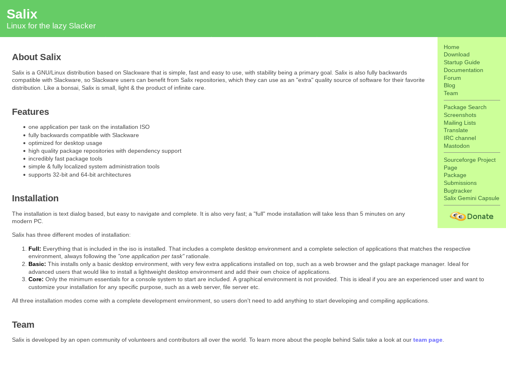

Well, it's been 13 years since the [last update](/post/new-website-design). It
was probably time for another.

First, for the sake of posterity, here's a screenshot of the old design:

As you can see, the new design is not really very different. Of course, this is
deliberate. The old website had some interesting advantages that I wanted to
keep no matter what. First, it was really small and loaded blazingly fast.
Second, it didn't use any JavaScript. Third, it didn’t look like yet another
startup-oriented website full of marketing material. You know, the kind most
websites seem to favor these days.

And that's exactly how the new website is too.

You’ll find that the menu has moved to the top of the screen, the font is a bit
bigger, the side margins are wider, and the site adapts much better to mobile
screens. But otherwise, it follows the same ideas.

Sure, we've moved a few things around. There is now a single
[community](/community) page that lists all the ways to get in touch or get
involved, for example. Some links that were previously in the vertical sidebar
have been moved to this page.

The most important change is not immediately obvious. You would have to look at
the [Git repository](https://github.com/Salix-OS/www.salixos.org) to realize
that. The previous site was using a custom build process in which the content
was written in txt2tags and processed into the HTML files you saw online.

Now, it is a much more standardized process. The original content is now
written in Markdown, a format that's much more common than txt2tags. The
Markdown files are processed using [Hugo](https://gohugo.io), a popular static
site generator. In fact, we use the same process to build our
[documentation](https://docs.salixos.org) and this blog. We've already
[written](/post/new-docs-site) about the
[reasons](/post/startup-guide-moves-into-the-docs) why such a move makes sense,
so I won't reiterate those here. Converting the content was much easier
this time because the site had far fewer pages than the documentation did.

Oh, and the new site has dark mode now too. It switches according to your
desktop settings. I know some people love this stuff.

Let's see if we keep this design for another decade.
